### Hi, I'm Kamal 👋

Product designer who likes to ship. I co-founded **[ZenMode OS](https://zenmodeos.com/)**, a home screen that helps you and your friends put the phone down, and I build small open-source tools on the side.

Before that, I founded **[Licaverse](https://www.justkamalthings.com/licaverse)**, a gamified AI learning platform where an assistant called Lica made studying fun and a lot less stressful.

<a href="https://www.justkamalthings.com/#oss">
<picture>
  <source media="(prefers-color-scheme: dark)" srcset="assets/oss-dark.svg">
  
</picture>
</a>

Everything above is public. If one of them helps you, a ⭐ or an issue makes my day.

[justkamalthings.com](https://www.justkamalthings.com/) · [LinkedIn](https://linkedin.com/in/kamalraaj07) · [X](https://x.com/Kingkamal07) · kr07.work@gmail.com

Thanks for stopping by 🌱
